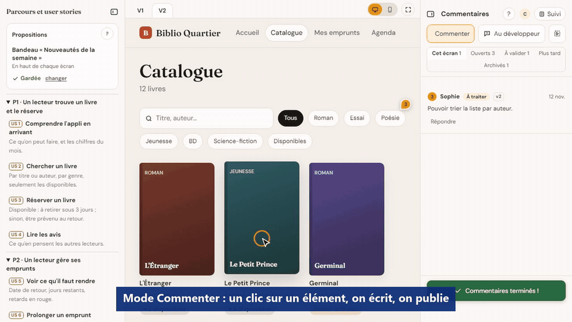

[English](README.md) · **Français**

# Salle de revue des maquettes

**Un client relit la maquette cliquable de sa future appli, et chaque remarque devient un ticket épinglé sur l'écran qu'elle concerne.**

*Un client commente un bouton, valide une correction, passe en vue téléphone, puis ouvre le suivi des retours. [Vidéo complète (1:09)](https://drive.google.com/file/d/1kWTjTzTzcR9my6LDSRhe65YpRfEufQX8/view)*

## Ce qu'on fait avec

- **Un lien par projet.** Le client tape le mot de passe du projet, puis son nom et son e-mail : aucun compte.
- **Tout se commente.** En mode Commenter, un clic sur n'importe quel élément, une section ou une user story, ou une phrase sélectionnée. Chaque remarque est soit un changement sur le site, soit une question pour moi, avec des captures au besoin.
- **Statuts.** Chaque fil a un numéro et un statut. Un fil corrigé attend que le client le valide ; un clic sur un fil ouvre son écran et encadre l'élément.
- **Versions et vues.** Un onglet par version ; les anciennes restent en ligne avec leurs fils. Un interrupteur montre la maquette dans un cadre de téléphone de 390 pixels.
- **Propositions.** Ce que l'IA ajoute sans demande est construit éteint ; le client le regarde, puis le garde ou non.
- **Commentaires terminés.** Un bouton me prévient par mail que le client a fini.

## Architecture

## Déploiement

- **Hébergement.** VPS personnel, Docker derrière Traefik : hub nginx, porte à mot de passe et service de commentaires (tous deux en Python).
- **Accès.** Un mot de passe par projet, un pour moi ; les agents IA reçoivent un laissez-passer de 15 minutes par défaut pour un seul projet.
- **Gabarit.** Une seule copie, chargée par toutes les maquettes ; un vérificateur en lecture seule (Node.js, Playwright) refuse une maquette qui s'en écarte.
- **En service.** Depuis le 8 novembre 2026 : 10 projets, 43 versions archivées (17 novembre 2026).

---

**Anthony Hunt** · [ingevision.cloud](https://ingevision.cloud/?p=revue-maquettes) · [LinkedIn](https://www.linkedin.com/in/anthony-hunt-3948a9196) · [GitHub](https://github.com/anthohunt)

Le code, les maquettes et leurs commentaires sont privés.
