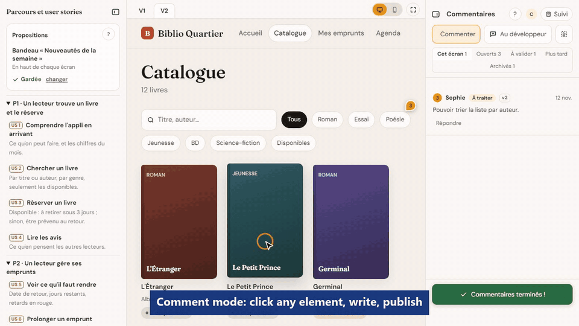

**English** · [Français](README.fr.md)

# Mock-up review room

**A client reviews the clickable mock-up of their future app, and every remark becomes a ticket pinned to the screen it is about.**

*A client comments on a button, validates a fix, switches to the phone view, then opens the tracking list. Interface in French. [Full video (1:09)](https://drive.google.com/file/d/1bsHL1GMqEnPEjqY7Iu4WtfTM4GwBkhOU/view)*

## Using it

- **One link per project.** The client types a name and is in: no account.
- **Comment anything.** In comment mode, click any element, a section or a user story, or select a sentence. Each remark is either a change to the site or a question for the developer, with screenshots if needed.
- **Threads are tickets.** Each one has a number and a status. A fixed thread waits for the client to validate it; clicking a thread opens its screen and highlights the element.
- **Versions and views.** One tab per version; older versions stay online with their own threads. A switch shows the mock-up in a 390-pixel phone frame.
- **Proposals.** Anything nobody asked for is built switched off; the client looks at it, then keeps it or not.
- **Comments done.** One button emails the builder that the client has finished.

## Architecture

## Deployment

- **Hosting.** Personal VPS, Docker behind Traefik: nginx hub, password door and comment service (Python).
- **Access.** One password per project, one for the owner; agents get a 15-minute pass for a single project.
- **Template.** One copy, loaded by every mock-up; a read-only checker (Node.js, Playwright) fails a mock-up that drifts from it.
- **In use.** Since 8 November 2026: 10 projects, 43 versions archived (17 November 2026).

---

**Anthony Hunt** · [ingevision.cloud](https://ingevision.cloud/?lang=en&p=revue-maquettes) · [LinkedIn](https://www.linkedin.com/in/anthony-hunt-3948a9196) · [GitHub](https://github.com/anthohunt)

The code, the mock-ups and their comments are private.
